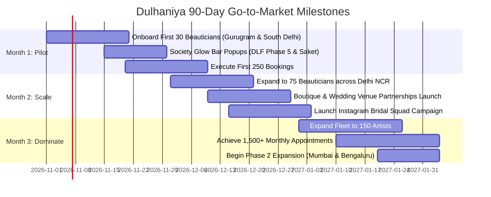

# 🚀 Dulhaniya - Step-by-Step Go-to-Market (GTM) Blueprint & Scaling Strategy

**Target Market:** India's $20 Billion Wedding & At-Home Beauty Economy  
**Target Geo:** Phase 1 (Delhi NCR: South Delhi, Gurugram, Noida) ➔ Phase 2 (Mumbai, Bengaluru, Jaipur)  
**Core Mission:** Empower independent female beauty professionals with 75%+ earnings while delivering transparent, 100% hygienic bridal and salon services directly to customers' doorsteps.

---

## 1. Executive Summary & Market Positioning

Traditional salon aggregators suffer from three critical flaws:
1. **Opaque Pricing & Equipment Lock-in:** Forcing per-minute metered charges or inflated product markups.
2. **Gig Worker Exploitation:** Taking 40%–50% commission cuts from beauticians, resulting in high churn and low morale.
3. **Hygiene Distrust:** Customers fear contaminated wax pots, expired creams, or unverified staff entering their private homes.

**The Dulhaniya Solution:**
- **For Customers:** 100% single-use SafeSeal™ monodose packs opened in front of the client, patent-free **Bring-Your-Own-Product (BYOP)** labor pricing, secret 4-digit OTP security, and background-verified female professionals.
- **For Gig Beauticians:** 75%–80% payout share, 100% of customer tips, instant UPI daily settlements, free initial disposable tool kits, and 24x7 emergency SOS safety dispatch.

---

## 2. Supply-Side Acquisition: Onboarding 100+ High-Quality Beauticians

A two-sided marketplace succeeds or fails on the reliability and skill of its supply side.

### Phase 2.1: The Talent Sourcing Funnel
1. **Beauty Academy Partnerships:**
   - Partner with graduating cohorts at **VLCC Institutes**, **Orane International**, **Habib's Academy**, and **Blossom Kochhar College**.
   - Offer newly certified artists instant, dignified freelance livelihoods without the upfront cost of opening a parlor.
2. **Bridal Freelancer Transition:**
   - Target freelance makeup artists (3–8 years experience) advertising on Instagram, WedMeGood, and ShaadiSaga.
   - Proposition: Dulhaniya handles demand generation, payment collection, customer customer service, and sealed inventory so artists can focus purely on craft.
3. **Neighborhood Micro-Hub Referrals:**
   - Launch a **"Beautician Sisterhood Referral Program"**: Existing verified artists earn ₹1,500 for every qualified peer they refer after that artist completes 10 successful ratings (minimum 4.8★).

### Phase 2.2: 4-Step Verification & Certification Onboarding
```
[Step 1: Digital KYC] ➔ [Step 2: Practical Skill Trial] ➔ [Step 3: Police & Safety Check] ➔ [Step 4: SafeSeal Induction]
   (Aadhaar + Voter ID)      (Live D-Day & Facial Demo)        (Court/Police Background)         (Sterilization Kit Issued)
```
1. **Government Identity & Background Verification:** Strict Aadhaar e-KYC and local police record verification.
2. **Practical Audition:** Master esthetician evaluates facial massage strokes, airbrush blending, and saree pleating.
3. **Hygiene & Sterilization Bootcamp:** Half-day workshop on autoclave sterilization, SafeSeal packet handling, single-use disposal protocol, and customer interaction etiquette.
4. **Partner Starter Kit:** Provide branded waterproof salon organizer bag, UV sterilization case, nitryl gloves, face masks, disposable biodegradable capes, and digital QR badge.

### Phase 2.3: Retention & Financial Empowerment
- **75%–80% Take-Home Pay:** Direct competitive advantage over legacy platforms charging 45% commission.
- **Zero Commission on Tips:** 100% of customer tips entered at checkout go straight into the artist's pocket.
- **Daily UPI Payouts:** Automatic evening payouts via RazorpayX/Cashfree directly to the artist's bank account.
- **Safety Guarantee:** Customer addresses are pre-verified; live trip monitoring with 24x7 panic SOS connection to local Women Helpline (1091/112).

---

## 3. Demand-Side Acquisition: Winning Brides & Repeat Households

### Phase 3.1: Wedding Ecosystem Partnerships (B2B2C)
1. **Bridal Boutiques & Lehenga Stores:**
   - Partner with premier wedding apparel hubs in **Chandni Chowk**, **Shahpur Jat**, and **South Extension**.
   - Provide co-branded *"Dulhaniya Bridal Glow Trial Passes"* (₹1,000 value) included with every lehenga purchase over ₹30,000.
2. **Banquet Halls & Farmhouses:**
   - Establish exclusive or preferred salon partner desks with wedding venues across Chattarpur, GT Karnal Road, and Sohna Road.
   - Offer venues a 5% commission on wedding party booking packages (Mother of the Bride, Bridesmaids, Saree Draping masterclasses).
3. **Wedding Photographers & Planners:**
   - Photographers love Dulhaniya makeovers because HD airbrush products prevent camera glare and flashback. Co-market bridal portfolio packages with top regional wedding cinematographers.

### Phase 3.2: Hyper-Local Gated Community Activations
- **Weekend "Bridal & Wellness Glow Bars":**
  - Set up elegant pop-up consultation lounges in large upscale apartment complexes in Gurugram (DLF Phase 5, Nirvana Country) and Noida (ATS, Jaypee Greens).
  - Offer complimentary 10-minute digital skin analysis + single-use organic fruit pack testing.
  - Convert 20%–30% of visitors into monthly repeat facial/waxing subscribers.

### Phase 3.3: Digital Marketing & Content SEO
1. **Instagram & Meta Reels Engine:**
   - Video hooks: *"What Salons Charge for Bridal Makeup vs What It Actually Costs"*, *"Watch Us Break Open the Sealed Monodose Kit at Home"*, *"Traditional Saree Draping in 12 Minutes Flat"*.
   - Influencer collaboration: Micro-influencer brides documenting their real 7-Day Pre-Bridal Countdown with Dulhaniya.
2. **Google Local Search & SEO Dominance:**
   - Optimize for high-intent queries: *"airbrush bridal makeup artist Delhi NCR"*, *"salon at home South Delhi"*, *"Rica waxing home service Gurugram"*, *"O3+ facial at home price"*.
   - Rich snippets powered by JSON-LD `BeautySalon` and `FAQPage` schemas embedded in [`public/index.html`](public/index.html).

### Phase 3.4: Viral Referral Loops & "Bridal Squad" Bundles
- **The "Dulhaniya Bride Squad" Offer:** When the bride books her D-Day Makeup, her bridal party (mother, sisters, bridesmaids) receives 25% off on saree draping and cocktail makeovers.
- **Friend Glow Passes:** Upon service completion, the customer receives 3 sharable ₹500 discount links via WhatsApp for her friends.

---

## 4. Unit Economics & Financial Modeling

### Typical Order Profiles:
| Category | Avg. Ticket Size | Platform Fee (25%) | Partner Payout (75%) | Kit / Disposables | Net Margin |
| :--- | :---: | :---: | :---: | :---: | :---: |
| **Monthly Salon (Wax + Facial + Pedi)** | ₹2,400 | ₹600 | ₹1,800 | ₹120 | ₹480 (20%) |
| **Pre-Bridal Ritual (Haldi/Mehendi)** | ₹4,999 | ₹1,250 | ₹3,749 | ₹250 | ₹1,000 (20%) |
| **Grand D-Day HD Bridal Airbrush** | ₹10,999 | ₹2,750 | ₹8,249 | ₹500 | ₹2,250 (20.5%) |
| **7-Day Bridal Countdown Package** | ₹8,499 | ₹2,125 | ₹6,374 | ₹400 | ₹1,725 (20.3%) |

- **Blended Average Order Value (AOV):** ₹3,850
- **Customer Acquisition Cost (CAC):**
  - Community Popups: ₹280
  - Digital Meta/Google Ads: ₹480
  - Organic / Boutique Referral: ₹120
- **Repeat Purchase Behavior:** Estimated 42% repeat booking rate within 45 days for routine maintenance (waxing, threading, hair spa).

---

## 5. 90-Day Execution Roadmap



### Month 1 (Weeks 1–4): Focused Hyper-Local Pilot
- Focus exclusively on **South Delhi (Saket, GK, Hauz Khas)** and **Gurugram (Golf Course Road, DLF Phase 1-5)**.
- Recruit and verify first **30 top-tier female artists**.
- Target: 250 completed appointments with 4.9+ CSAT rating.

### Month 2 (Weeks 5–8): NCR Expansion & B2B Partnerships
- Expand to **Noida, Dwarka, and West Delhi**.
- Formalize 15 bridal boutique partnerships in Chandni Chowk & Shahpur Jat.
- Scale fleet to **75 active professionals**.
- Target: 750 monthly appointments.

### Month 3 (Weeks 9–12): Wedding Season Acceleration
- Scale fleet to **150+ professionals**.
- Launch corporate women wellness packages and bridal countdown retainers.
- Achieve ₹45,00,000 monthly GMV run rate.
- Prepare Phase 2 city launch (Mumbai & Bengaluru).
